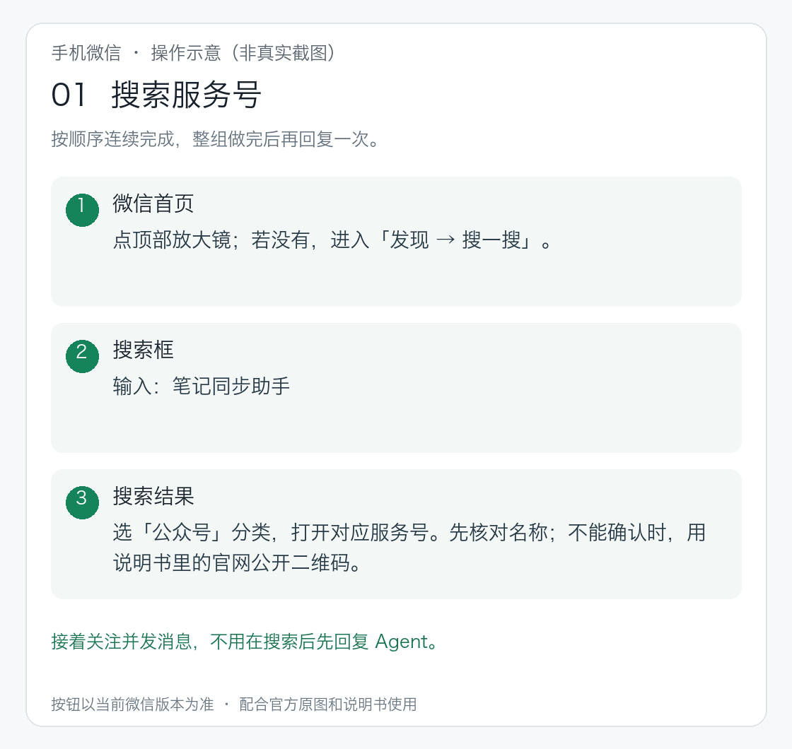
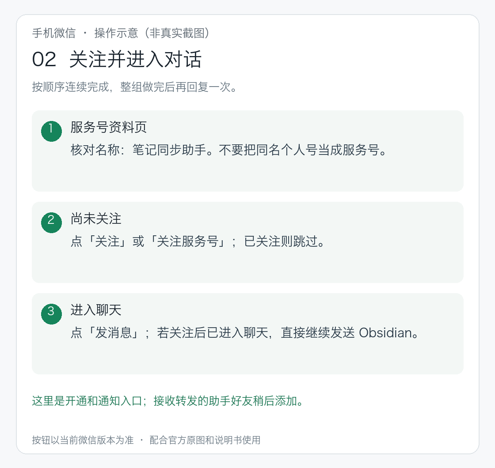
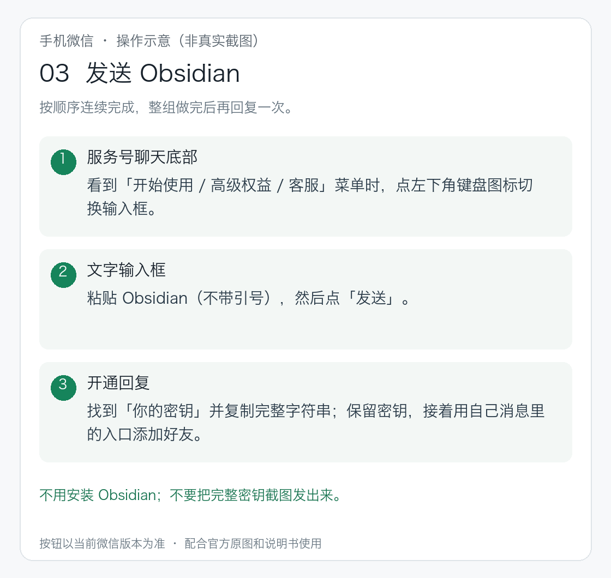
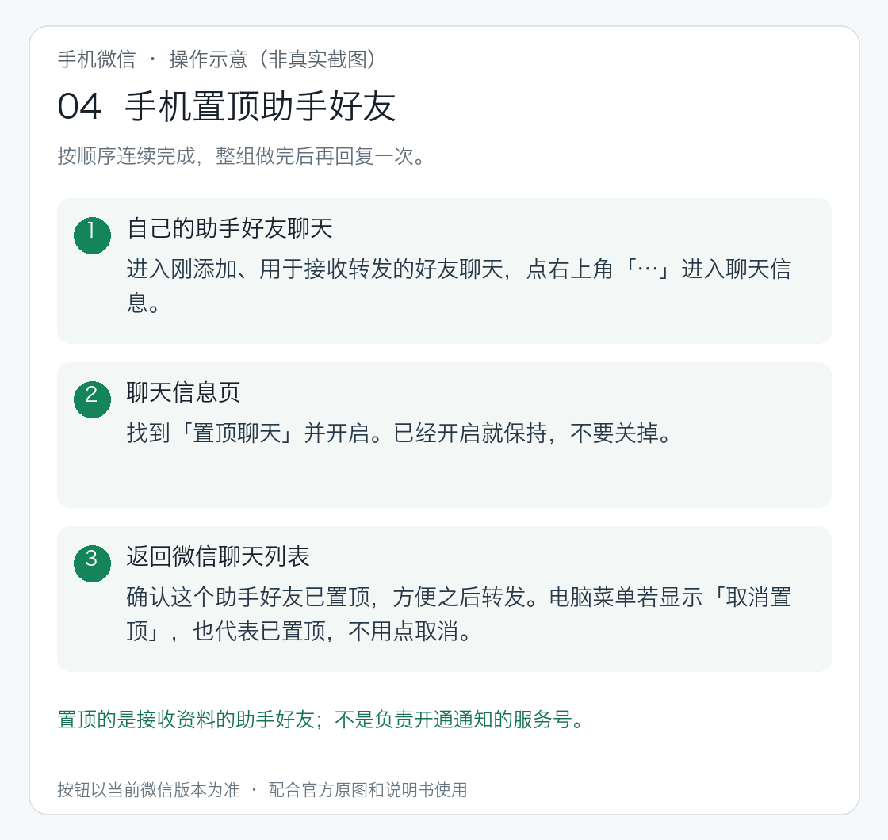
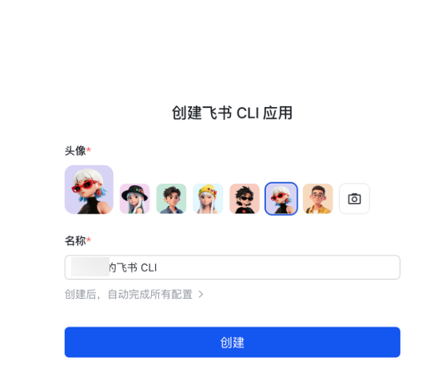
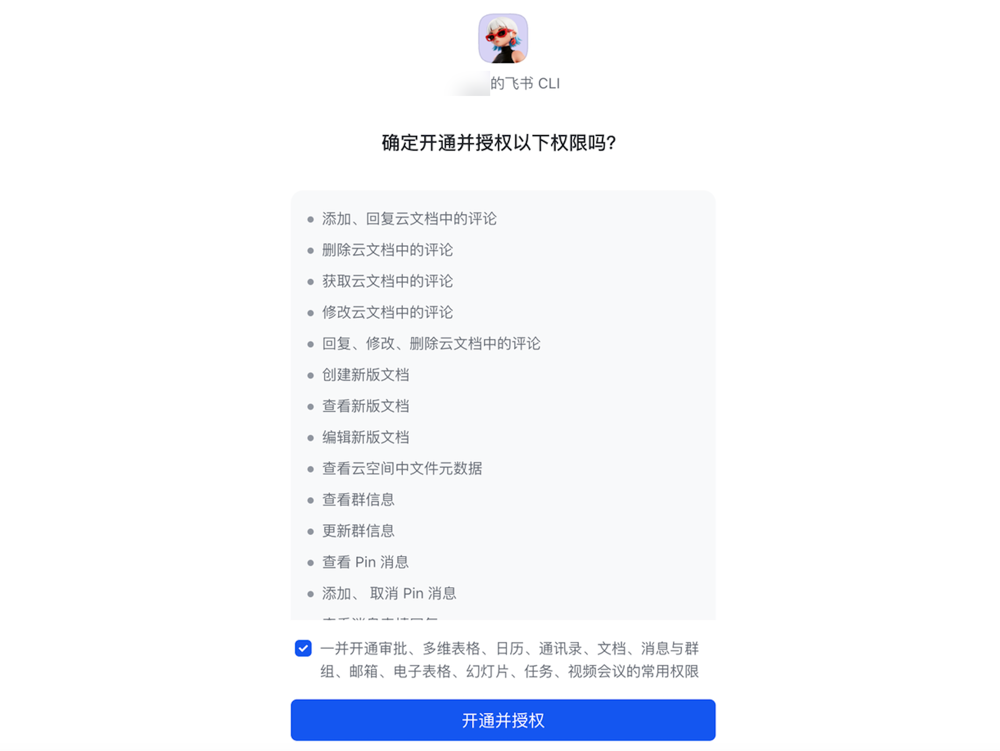

# 按组交接：可直接组织成用户消息的示例

本文件是实际发给用户的消息范式。每组全部步骤与对应图片一次发送，组内无需用户逐点确认；用户做完后只回复一次，遇到问题可随时打断。发送时把本地图片路径解析为当前解压目录下的绝对路径并实际显示，不只发路径。已有步骤跳过，未发生的检查不写成成功。

用户已会把包或路径交给 WorkBuddy，不增加 WorkBuddy 入门教程。先由 Agent 完成飞书只读检查与环境准备，再交接需要本人完成的组。图片中的官方样例不代表当前账号状态；用户打码图另注明来源。细节与排障见 [微信说明](notehelper-setup.md)、[飞书说明](feishu-setup.md)和[官方排障入口](help-and-official-docs.md)。

## 第 1 组：关注、取密钥、添加好友、置顶

Agent 一次发送以下完整内容及八张图片（四张操作示意、四张原有参考图）；不是发一句等一句。已有密钥或好友时只保留缺少的动作。

> 现在请在自己的微信里连续完成下面这组操作，做完后一次回复我就好，不用每点一下就回来确认。
>
> **① 搜索、关注并进入服务号。** 打开微信顶部搜索（或“发现→搜一搜”）→输入“笔记同步助手”→选“公众号”分类→打开对应服务号；也可用微信扫一扫下面的公开二维码，核对名称是“笔记同步助手”，点击“关注服务号”→“发消息”；已经关注就直接进入对话。手机上看图时，保存图片→微信“＋”→“扫一扫”→相册→选图。

> **② 发送 Obsidian，找到密钥。** 如果底部是“开始使用 / 高级权益 / 客服”菜单，点左下角小键盘图标切换文字输入，发送下面这个单词：
>
> Obsidian
>
> 收到开通消息后，找到“🔑你的密钥”，复制后面的完整字符串，先保留。图片中的密钥已遮挡，要从自己的消息里取；不用点下载链接，也不用安装 Obsidian。

> **③ 添加自己的助手好友。** 接着在同一条开通消息中滑到最下面，点添加好友图片，按提示识别或打开自己的好友入口，点“添加到通讯录”或实际页面上的添加按钮，完成添加并进入聊天。必须用你自己消息里的入口，不扫描别人或教程中的个人绑定码。

> **④ 把接收资料的助手好友置顶。** 电脑微信聊天列表中右键刚添加的好友→“置顶”；菜单如果是“取消置顶”，说明已经置顶，保持即可，不要点击取消。手机微信在这个助手聊天的“…”或聊天信息中找到“置顶聊天”并开启，以当前界面为准。置顶助手好友，方便以后转发，不是置顶服务号。

> 新增四张手机图为本项目制作的操作示意，均标明“非真实截图”，用于说明连续动作和完成状态；按钮以当前微信为准。上面最后一张是用户提供的电脑微信截图，顶部已标“已置顶，不用点取消”，经隐私处理和标注，其他聊天已遮盖；不是手机或官方原图。前面的添加按钮图仅借用 OneNote 教程里的微信按钮，不需要连接 OneNote。自己的好友可能叫 Obsidian 或同步助手，以自己的开通入口为准。
>
> **这一组做完后，一次回复：**“助手好友已添加并置顶”，并在同一条回复里粘贴自己的密钥。我来保存和验证，不会回显密钥。密钥会进入当前 Agent 的聊天记录，工具记录也可能留存；不要发含完整密钥的截图。
>
> 如果某一步界面不同，告诉我卡在哪一步、看到的按钮或提示文字即可，不用从头来。
>
> 官方说明：[开通、密钥与自己的好友入口](https://www.bijitongbu.site/tutorials/obsidian-tutorial/) · [关注二维码](https://www.bijitongbu.site/) · [添加按钮图源](https://www.bijitongbu.site/tutorials/onenote-tutorial/)。

用户回复后 Agent 保存并只读校验密钥；未经真实校验不宣称已连接。用户主动拒绝聊天传密钥时按微信说明 C 的内部兜底处理，不把兜底变成默认选择菜单。

## 第 2 组：打开资料、转发、查看完成通知

第一组完成且密钥验证通过后，一次发送本组全部动作和图片，不在选择联系人、发送成功时插入确认轮。

> 现在选一篇你愿意测试的文章，连续完成下面操作；做完后告诉我标题，我来读取并保存到你确认的飞书位置。
>
> **① 打开文章，点右上角“…”→“转发给朋友”。** 如果是只有复制链接的平台，复制链接后粘贴到自己的助手好友聊天并发送，随后继续看完成通知。

> **② 选择自己的助手好友。** 在“选择聊天”里搜索并点选刚才添加的助手，核对是接收资料的好友，不是发通知的服务号。名字以你自己的好友为准，不必与图中“同步助手”完全相同。

> **③ 确认收件人和资料标题，点绿色“发送”。** 看到“已发送”，或好友聊天里出现这条内容，就继续下一项，不用先回来回复。

> **④ 返回聊天列表→“服务号”→“笔记同步助手”，等处理完成通知。** 开始处理不等于完成；看到“笔记已同步”等完成消息后，这一组才结束。视频较长时先等，不要重复转发。

> **这组完成后，一次回复：**“已处理完成，标题是……”。若显示失败或一直没有通知，直接告诉我实际提示，我查官方说明帮你排查。
>
> 前五张是官方 OneNote 教程的通用微信按钮示例；实际选自己的 Obsidian 助手，不连接 OneNote。处理完成只代表笔记同步助手云端就绪，之后由我读取并写入飞书。
>
> 官方说明：[微信按钮图源](https://www.bijitongbu.site/tutorials/onenote-tutorial/) · [处理通知](https://www.bijitongbu.site/tutorials/obsidian-tutorial/) · [无通知等问题排查](https://www.bijitongbu.site/tutorials/sync-troubleshooting/)。

## 第 3 组：飞书应用创建（仅确实缺少可复用应用时发送）

已接好飞书的用户跳过第 3、4 组；仅缺个人登录时跳过第 3 组。Agent 先核实第 1 节飞书分支、启动并保留真实配置进程，取本次配置链接、生成二维码。发送时必须用当前命令的真实结果替换动态链接，并显示真实二维码；不能把说明里的占位文字当成链接交给用户。

> 飞书应用尚未配置，我已准备这次的配置入口。请连续完成：
>
> **打开本次配置链接或扫描本次二维码 → 用要保存资料的飞书账号登录 → 核对账号和组织 → 在“创建飞书 CLI 应用”页面按要求填写名称、选择头像 → 阅读页面提示，点“创建” → 等页面显示成功。** 名称可用“我的笔记助手”，不用照抄示例。

此处由 Agent 插入本次真实配置链接与二维码，然后展示下图；不需要用户先回复“打开了”或“登录了”才继续给表单操作。

> **整组成功后回复一次“应用建好了”。** 若提示组织不允许创建、链接过期或其它错误，把提示文字告诉我，不用重复创建。
>
> [官方创建应用图文说明](https://www.feishu.cn/content/article/7644418854143315157)。

用户整组完成后，Agent 先读取真实配置结果，再发起 OAuth 并发送第 4 组；真实授权链接依赖应用配置完成，所以两组之间必须交接，不能预造第二个链接。页面要求本人同意协议、组织审批或授权时由用户本人完成。

## 第 4 组：飞书个人授权（仅需要时发送）

Agent 已取得本次 verification_url/device_code、生成本次二维码后，一次发送完整操作与图。后台续接和 verify 由 Agent 完成。

> 现在完成这一组个人授权：
>
> **打开本次授权链接或扫描本次二维码 → 如果提示登录，用要保存资料的飞书账号登录 → 核对账号和刚才配置的应用 → 阅读本次文档与云空间权限 → 按页面“授权”或“开通并授权”继续，完成后续确认 → 等页面显示授权成功。**

此处由 Agent 插入本次真实授权链接与二维码，并展示下面的历史界面图；不要让用户回报每个按钮。

**下图是官方历史界面，含多个业务域的权限示例，不能照着全选。本包实际发起 docs,drive，用户应核对本次真实页面。**

> **这组成功后只回复一次“已授权”。** 若显示过期、无权授权或权限与你预期不符，告诉我提示文字，我来处理，不用重新建应用。
>
> [官方授权图文说明](https://www.feishu.cn/content/article/7644418854143315157)。

用户回复后 Agent 使用本次 device_code 续接、验证身份与权限。验证通过才报告成功；过期仅重发新的这一组，不退回全权限、不重新创建应用。之后把选定资料、拟保存位置与写入意图合并为一次确认，用户已经明确授权过的同一写入不重复询问。由 Agent 创建并读回，报告实际文档 URL 和正文/图片核对结果。

## Agent 内部：同名候选确认后只处理选定一条

候选有多条时，一次列出标题、来源 URL、作者、保存时间供用户辨认，合并询问选哪条及保存位置；不要先读取所有候选正文。确定条目后记录该条 id 和 result_after；保持同一 query，使用 --limit 1、--after 对应位置、--id 对应 ID、--content 请求。返回正文 ID 必须等于选定 ID，导出最多一条，再按同一 ID 对照准备飞书写入。没有 --id 或 limit 不为1，客户端在请求前拒绝；空结果、多条或 ID 变化均拒绝输出/导出。需要时重新检索元信息，不扩大正文范围。官方仅公布搜索/分页，没有独立按 ID 获取正文的指引；客户端不虚构此类接口。服务若违背单条分页约定可能返回其它正文，客户端会拒绝结果，不声称服务端绝对不会返回未选正文。

## 第5组：用户打开测试文档验收，并确认定时规则

Agent 已按实际授权创建测试文档并读回核对后，一次发送：

> 测试资料已写入：[实际文档链接]。请打开确认正文、图片和来源是否完整。确认正常后，告诉我希望多久同步一次，并确认以后仍保存到这个文件夹。首次默认从启用时起收集新增资料，不导入已有历史。我来创建定时任务，并从定时任务本身试跑、核对不会重复建文档。

已有目的地、时间规则和时区就合并复述求确认，不重复提问。测试未通过先修正，不启用任务。这里只需要一轮合并反馈；用户未给频率时只补问频率。

## 第6组：需要用户进入定时入口时才发送

默认由 Agent 创建和设置，只有当前窗口无创建能力或确需本人点击时，按 [定时设置第3节](scheduling-setup.md)整组发送：固定目录的续接说明、定时入口、填写内容、两张官方界面图和完成后回复什么。不要把每个菜单/表单字段拆成确认轮。若当前宿主根本没有定时能力，就报告实际未设置，不让用户盲目重开多个窗口。

创建后由 Agent 读回任务详情并“立即运行”。基线后还没有新增资料时，空跑不足以验收写入：再一次发齐第2组转发动作与图片，请用户转发一条新的测试资料，从同一定时任务触发，读回成功后再触发一次验证去重。不要只测试配置文件存在。
