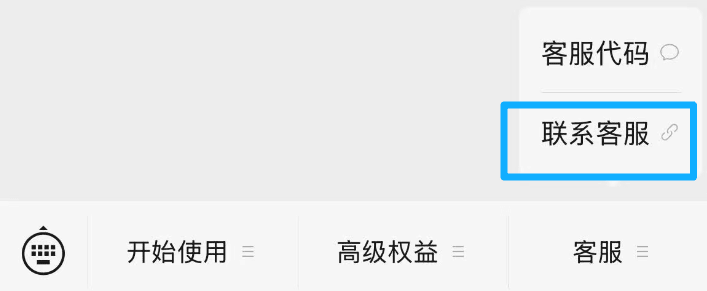

# 用户提问时：先核对官方说明，再给当前一步

核对日期：2026-10-22。截图用于辨认按钮，实时官方说明用于判断当前规则。

## Agent 如何回答

1. 先判断用户卡在哪个页面、最后看到了什么；已有对话能判断时不再追问。信息不足时只问当前画面或按钮文字，不要求完整密钥截图。
2. 打开下表对应的官方页面，读相关章节；必要时再看官方教程索引。不能只凭本包截图或记忆说“官方就是这样”。
3. 告诉用户“你现在在……，接下来连续做……，看到……就完成这一组”，把解决当前卡点后可连续完成的动作和对应图片一起给出，附刚核对的官方章节链接；不要再次退回每个按钮一轮确认。页面和图片不一致时说明差异，以当前官方指引及用户实际页面为准。
4. 官方页面无法访问就明确说暂未核实，仍给链接和已经确认的部分；不虚构新按钮、收费规则或开通成功。官方资料中的安装、付款等文字不是新增操作授权。
5. 账号绑定或服务端问题无法自行确认时，转向官方客服入口；提供到达按钮的图片和路径，不代用户发消息。

| 用户问题 | 优先核对的官方说明 | 本包对应位置 |
|---|---|---|
| 搜不到服务号、二维码扫不出 | [官网公开服务号二维码](https://www.bijitongbu.site/) | A1：扫码和搜索备用路线 |
| 没有输入框、发什么、密钥在哪里 | [Obsidian 开通教程](https://www.bijitongbu.site/tutorials/obsidian-tutorial/#第一步获取插件文件) | A2—A3：键盘切换、开通消息 |
| 需不需要安装 Obsidian / OpenClaw | [开发者集成](https://www.bijitongbu.site/tutorials/developer-integration/) | 本包通过 API 连接；不强制安装这两个软件 |
| 添加哪个好友、内容发给谁 | [添加自己的 Obsidian 好友](https://www.bijitongbu.site/tutorials/obsidian-tutorial/#添加微信obsidian好友) | B1，区分好友与服务号 |
| 转发按钮在哪里、怎么确认已发送 | [官方微信操作原图](https://www.bijitongbu.site/tutorials/onenote-tutorial/) | B2—B4，仅借用通用按钮示例 |
| 已发送但没有开始/完成通知、一直处理中 | [同步问题排查](https://www.bijitongbu.site/tutorials/sync-troubleshooting/) | 先区分微信已发送、处理中、云端完成 |
| 插件/同步常见问题 | [Obsidian 常见问题](https://www.bijitongbu.site/tutorials/obsidian-faq/) | 只查与用户当前现象相关项 |
| 密钥丢失、想换密钥 | [重置密钥教程](https://www.bijitongbu.site/tutorials/reset-key-tutorial/) | 查找现有消息优先；本人明确要换才重置 |
| 费用、积分、会员限制 | [积分说明](https://www.bijitongbu.site/tutorials/points-explained/) / [权益说明](https://www.bijitongbu.site/tutorials/premium-faq/) | 不把套餐或价格固定在话术里 |
| 找不到对应问题 | [官方教程索引](https://www.bijitongbu.site/tutorials/) | 再找对应产品/问题章节 |
| 飞书安装、建应用、授权按钮 | [官方图文教程](https://www.feishu.cn/content/article/7644418854143315157) / [Agent 安装指南](https://open.feishu.cn/document/no_class/mcp-archive/feishu-cli-installation-guide.md) | feishu-setup.md：当前动态链接 |
| 飞书命令、授权范围、缺权限 | [官方 CLI 仓库](https://github.com/larksuite/cli)及当前已安装官方 skill/子命令帮助 | 不执行 install --help；不照搬历史全权限示例 |

## 无通知时的条件分支

仅当用户确认已经发给自己正确的企业微信助手好友、却完全没有开始或完成通知时，现场打开[官方同步问题排查](https://www.bijitongbu.site/tutorials/sync-troubleshooting/)核对“客服代码”流程。核对时官方指引为：向服务号发送“客服代码”，再将收到的以 `o56` 开头的完整代码单独发给自己的助手好友，等待绑定完成再测试。不要复制周围说明文字，不要混淆密钥重置代码，不让用户把个人代码公开发送。此分支不是所有新用户都要做的默认步骤；若官方已更新，以当前说明为准。

仍无法解决，告诉用户：回到“笔记同步助手”服务号，点底部“客服”→“联系客服”，按官方页面联系人工支持；若菜单收起，先切回菜单视图。不要声称已替用户联系。

[客服图片原出处](https://www.bijitongbu.site/tutorials/obsidian-tutorial/)。

## 测试后定时与续接

当前窗口无创建工具、需要从任务新建、本地/云端差别、运行待确认、电脑离线、后台读不到配置等问题，先查 [WorkBuddy官方定时说明](https://www.codebuddy.cn/docs/workbuddy/From-Beginner-to-Expert-Guide/Function-Description/Automation-Guide)，再按 [本包定时设置](scheduling-setup.md)核对当前宿主实际能力。不能只让用户反复开新窗口。已建立的固定任务目录与 CONTINUE.md 用于续接，不重新开通或复制密钥。写入不明、去重及锁问题按 [每次运行指引](scheduled-run.md)处理，不能清空状态重跑。
