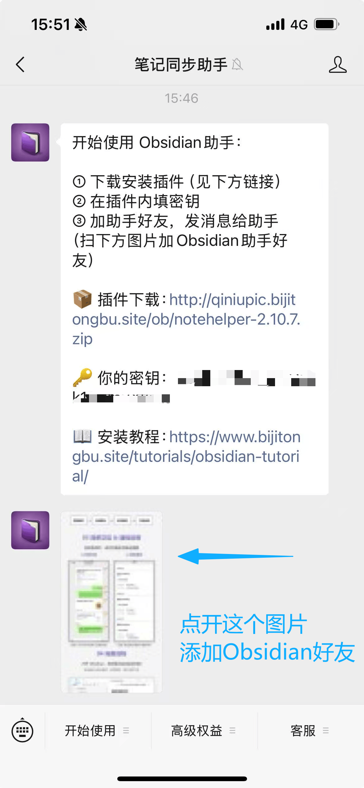
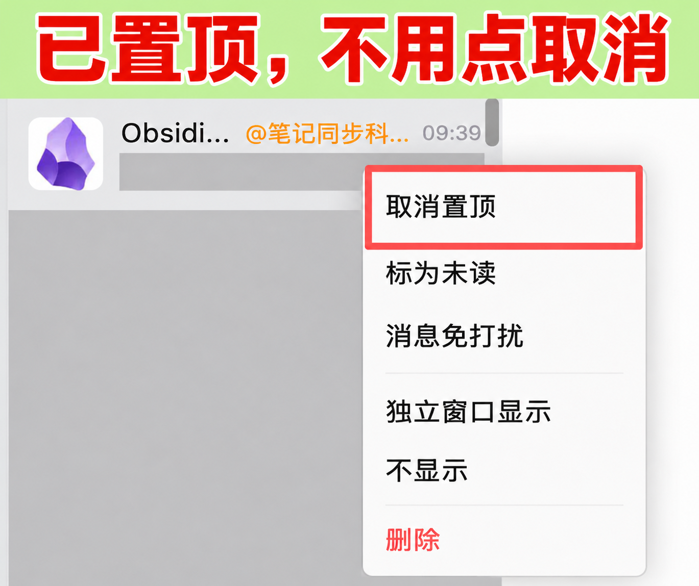
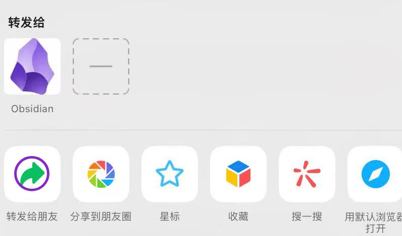
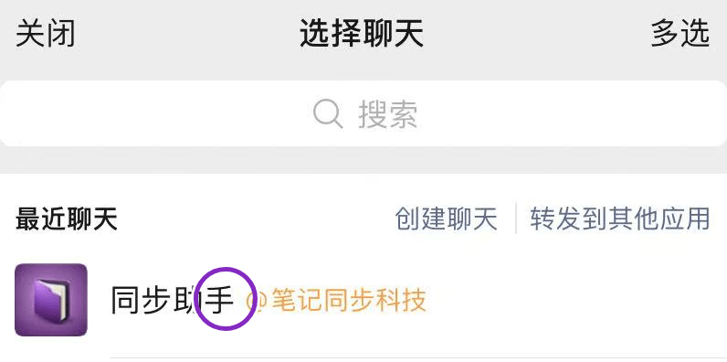
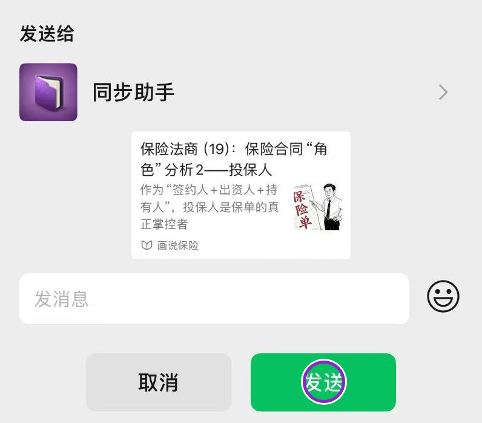
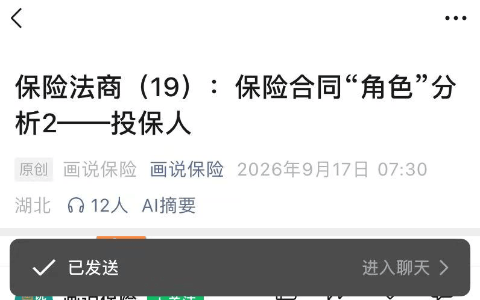
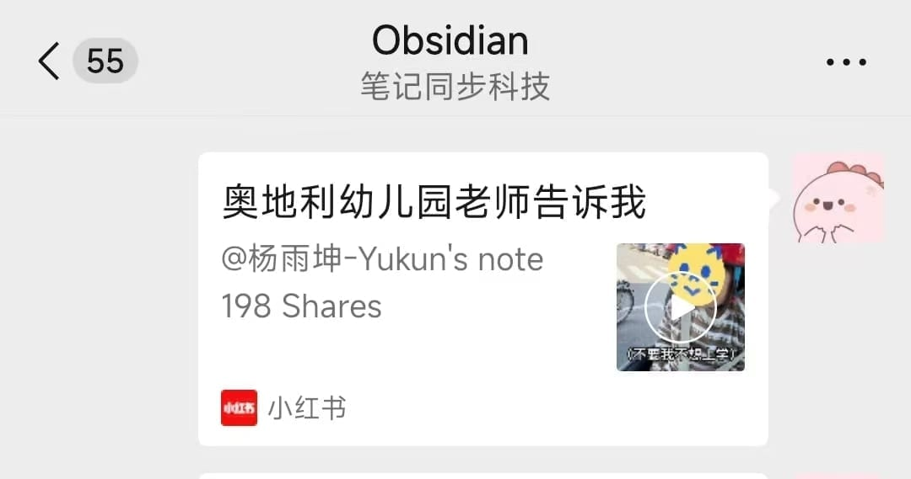
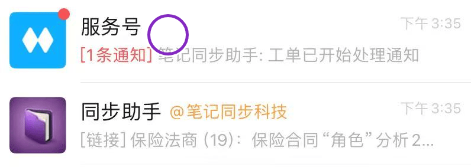
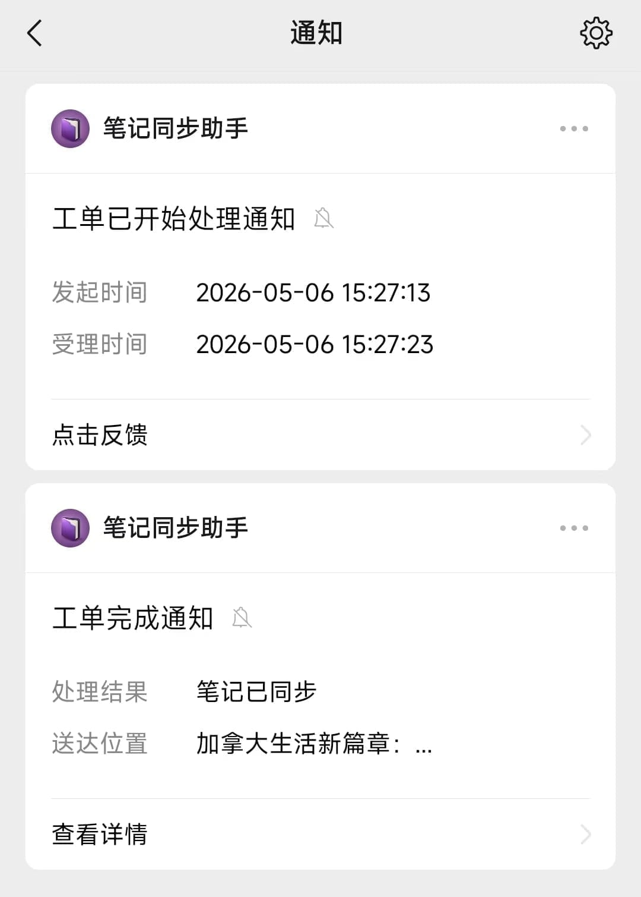
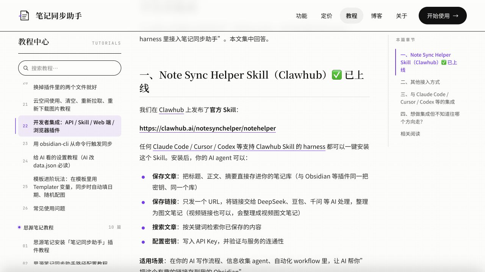

# 笔记同步助手：首次接入的具体步骤

核对日期：2026-10-22。Agent 当前只读取本阶段，不必让用户看整份技术文档。

## A. 用户获取自己的密钥

以下 A1—A3、B1、B1a 是同一组连续操作的小节，不是确认停点。Agent 按 [整组发送示例](grouped-messages.md)第 1 组一次发齐全部步骤和图片，用户添加并置顶好友、取得密钥后才回复一次。B2—B5 属于第 2 组，也需一次发齐，等云端完成后回复标题；用户遇到问题可随时打断。图片应在对话里实际显示；相对路径先按本文件位置解析为绝对路径。官方未提供的微操作截图会明确标注，不能用其它页面冒充。

### A1. 先关注服务号

向用户说：

> 我先带你找到正确的服务号。如果你在电脑上和我聊天，请打开手机微信，点右上角“＋”→“扫一扫”，扫描下面二维码；如果你就在手机上看这张图，先保存图片，再到微信“扫一扫”里点相册，选择刚保存的图片。进入后核对名字是“笔记同步助手”，点击“关注”或“关注服务号”；已关注的点“发消息”。进入对话后接着做下一项，不用先回来回复。


[二维码原出处：官网首页](https://www.bijitongbu.site/)。这是公开的关注二维码，不是个人助手绑定码。微信版本不同，按钮文字可能略有不同。搜索备用路线：微信顶部搜索→输入“笔记同步助手”→选择“公众号”分类→打开对应服务号→关注→发消息。**官网没有搜索结果、关注按钮的逐屏原图；这里给的是公开二维码和文字路线，不能声称已有这些截图。** 扫码失败先打开官网核对当前二维码，不让用户反复扫描失效图片。

### A2. 切换文字输入，发送 Obsidian

> 在刚才服务号的对话底部，如果看到“开始使用 / 高级权益 / 客服”菜单，请点左下角的小键盘图标，切换到可以打字的输入框。把下面这个单词复制进去，然后点“发送”：
>
> Obsidian
>
> 不用带引号或反引号。收到“开始使用 Obsidian 助手”之类的开通消息后，接着在消息里找密钥。



[官方获取密钥说明](https://www.bijitongbu.site/tutorials/obsidian-tutorial/#第一步获取插件文件)。这张官方原图展示开通后的结果和底部菜单，**没有展示发送单词的动作**。若用户找不到键盘按钮，先核实他在服务号聊天页，而不是账号介绍页或企业微信好友页；再查当前官方说明。发送后没有回复，先核对发送对象和文字，不反复申请或重置密钥。

### A3. 在开通消息中找到自己的密钥

> 在刚收到的开通消息里向上或向下滑动，找到“🔑你的密钥”这一行，复制它后面的那一整段字符串。上图中密钥已被官方遮住，不能复制图片里的内容，要从你自己的消息里取。这次不用点下载链接，也不用安装 Obsidian。
>
> 拿到密钥后先保留，继续添加并置顶助手好友；这组全部做完再一次回复。

本组只需附一次完整开通消息原图，同时说明密钥位置和底部好友入口，避免重复堆放同一张长图。长按自己的消息看是否有“复制”或文字选择；若整段复制包含安装说明，优先只选择密钥字符串。无法选取时不要要求用户发包含密钥的截图，按当前微信文字选择能力协助。尚未找到时不要要求重置密钥。用户主动提供密钥后，直接进入 C，不再要求重复发送。

密钥通过对话提供前，按 C 说明一次留存情况；提供后 Agent 不回显、不引用原消息。不要让用户上传完整开通消息截图。

## B. 微信转发：本包统一使用的资料入口

服务号用于开通和接收通知；用户自己添加的助手好友用于接收转发。名称可能显示为“Obsidian”或“同步助手”，带“笔记同步科技”标识，以用户自己开通消息里的入口为准。

### B1. 从自己的开通消息添加好友

> 回到你刚收到的开通消息，滑到最下面，点“添加好友”相关图片（上图底部蓝色箭头指出的位置）。如果打开的是二维码图，按当前页面提示识别；再核对资料页，点“添加到通讯录”或当前页面的添加按钮，需要确认时按提示完成。能进入好友聊天后，继续把这个好友置顶，暂时不用回来确认。


[本流程官方说明](https://www.bijitongbu.site/tutorials/obsidian-tutorial/#添加微信obsidian好友)；[添加按钮原图出处](https://www.bijitongbu.site/tutorials/onenote-tutorial/)。第二张来自官方 OneNote 教程，只演示微信添加按钮，不需要配置 OneNote。必须使用**用户自己消息里的入口**；示例图或其他用户的好友绑定二维码不能用于本人的绑定。

### B1a. 置顶自己的助手好友，方便以后转发

这是第 1 组的最后一个连续动作，添加好友后一起完成，不另起一轮。

> 在电脑微信聊天列表里，找到刚添加的助手好友，右键点击它，选择“置顶”。如果菜单已显示“取消置顶”，说明已经置顶，保持即可，不要点击取消。手机微信可打开这个助手聊天，点右上角“…”或聊天信息入口，找到“置顶聊天”并打开；按钮按你当前微信界面为准。置顶的是接收资料的助手好友，不是服务号。
>
> 这一组做完后，一次回复“助手好友已添加并置顶”，并把自己的密钥粘贴在同一条回复里。我来保存和验证。密钥会进入当前 Agent 的聊天记录，工具记录也可能留存，我不会回显；不要发含完整密钥的截图。



图片顶部明确标注“已置顶，不用点取消”。图源为用户提供的微信桌面端截图，经 AI 辅助隐私打码与文字标注；不是官方原图，其他聊天头像、名称和消息已遮盖。截图是“已经置顶”的状态；不能把图中的“取消置顶”当作用户要点击的按钮。移动端没有本包对应截图，按实际界面说明，不拿桌面图冒充手机图。第 1 组消息采用 [整组示例](grouped-messages.md)，只交接一次。

### B2. 打开一篇愿意测试的文章并选择转发

> 在微信里打开你愿意测试的那篇文章，点右上角“…”；在弹出的分享菜单中点“转发给朋友”。如果直接看到自己的助手好友也可以选择它。进入“选择聊天”页后接着选自己的助手好友，不用先回来回复。



[微信转发按钮原图出处](https://www.bijitongbu.site/tutorials/onenote-tutorial/)。B2—B5 的按钮图来自同一官方 OneNote 示例，仅演示通用微信操作；实际收件人是用户 B1 添加的 Obsidian 助手，不选 OneNote、不连接微软账号。其它平台若只有“复制链接”，可复制后粘贴给自己的助手好友；不要承诺所有内容平台都支持原生卡片转发。

### B3. 选择自己的助手好友

> 在“选择聊天”页搜索你刚添加的助手好友名字，点选它。核对这是刚才从你自己开通消息添加的好友，不是发通知的服务号。下一页应出现发送确认框，接着确认发送，不用在此回复。



[选择聊天原图出处](https://www.bijitongbu.site/tutorials/onenote-tutorial/)。图中“同步助手”仅为示例名字；不要要求用户必须找到完全同名的联系人。

### B4. 确认发送

> 看一下确认框顶部的收件人和文章标题，确认是你的助手和你选的那篇文章，再点绿色“发送”。看到“已发送”或好友聊天里出现内容后，继续查看服务号的处理通知，不用在此回复。





[发送与结果原图出处](https://www.bijitongbu.site/tutorials/onenote-tutorial/)。这里仅证明微信转发完成，解析和飞书写入还没有验证。



[Obsidian 实际收件示例出处](https://www.bijitongbu.site/tutorials/obsidian-tutorial/)。此图对应 Obsidian 好友，不必照抄示例链接。

### B5. 查看处理通知

> 回到微信聊天列表，进入“服务号”，再打开“笔记同步助手”。收到“开始同步/处理”表示已经开始；等到“笔记已同步”等完成消息后，再一次回复“已处理完成，标题是……”，我来读取和核对。视频较长时先等处理结果，不用重复转发。





[服务号入口图出处](https://www.bijitongbu.site/tutorials/onenote-tutorial/)；[处理通知官方说明](https://www.bijitongbu.site/tutorials/obsidian-tutorial/)。完成通知表示笔记同步助手云端就绪，不能据此宣称内容已进入飞书。无通知、报错或内容不完整时，先按[提问与排障](help-and-official-docs.md)查官方对应章节。

## C. Agent 配置与校验

默认使用官方 skill 约定的本机文件：`~/.openclaw/notehelper.json`。文件夹名沿用官方约定，不表示必须安装 OpenClaw。

已有 `NOTEHELPER_API_KEY` 时客户端优先用该环境变量；已有配置文件则由用户确认复用。不要扫描其它人的配置、复制分享包制作者的密钥，或把整个配置文件打印出来。

**默认入口：用户直接在 Agent 对话框提供个人密钥，配置全部由 Agent 完成。** 第一次请求前只说明一次：“直接发在这里也可以，我会保存到你的本机并验证；它会进入聊天记录，由当前 Agent 服务处理，工具记录也可能保留输入。”不把对话框说成安全输入表单，不承诺聊天或工具平台不留记录。

用户发送密钥后，Agent 只说“收到，我来保存并验证”，不引用原消息、不复述前后几位、不再要求用户开终端。Agent 从已核实的解释器启动：

```sh
"$TASK_PYTHON" "$TASK_CLIENT" configure --stdin
```

由 Agent 用宿主进程工具的 stdin 通道传一行密钥并关闭输入流。密钥不放 argv、环境变量命令或含密钥的临时源码。工具调用本身可能被宿主记录，不要向用户作无日志保证。仅支持 PTY 的宿主则由 Agent 启动普通 configure、等待 getpass 提示，再通过进程输入通道填入已收到的密钥；脚本关闭回显。用户不用参与这段命令。

已有配置默认不覆盖；如果环境变量已经有密钥，check 会优先使用它。用户要求换密钥时，Agent 还要核对并说明哪个密钥来源实际生效，不能只改文件就声称已切换。

本脚本不会修改 shell 启动文件。POSIX 配置文件权限设为 600；Windows 保存在本人的用户目录并遵循系统访问权限。脚本只报告路径和状态，不再打印密钥。

### 仅当用户明确不愿在对话框发送时的内部处理

优先使用宿主提供的本机安全输入能力；否则由 Agent 打开用户能操作的系统终端并启动普通 configure 的隐藏提示，然后告诉用户：“输入入口已经准备好，请在该窗口粘贴密钥并回车；看到 configured:true 后回复‘已保存’，我来校验。”**没有真实打开就不能说已准备好。**

若宿主确实无法打开可见终端，才使用人工兜底。Windows：请用户按 Win 键搜索并打开 PowerShell；Agent 给出已填好真实绝对路径的 `& '解释器路径' '客户端路径' configure` 一行，让用户复制执行后粘贴密钥。macOS/Linux 同样由 Agent 给出已填好绝对路径的命令，不让用户找目录或拼命令。隐藏输入没有字符显示是正常现象。以上例外不能成为默认路线。

然后由 Agent 执行：

```sh
"$TASK_PYTHON" "$TASK_CLIENT" check
```

校验使用官方 skill 公布的文章计数接口，不提交内容、不消耗链接解析积分。HTTP 成功且计数字段有效才通过。0 篇是正常的新账号。

## D. Agent 内部来源说明

[截图中的官方 NoteHelper Skill](https://clawhub.ai/notesynchelper/notehelper)就是同一服务的官方 Agent 接口说明；[官方开发者说明](https://www.bijitongbu.site/tutorials/developer-integration/)确认它与 Obsidian 插件使用同一密钥、同一个笔记库。本包附的客户端按其公布的接口读取微信转发后的笔记，不要求用户另外选择或安装官方 skill，也不安装 Obsidian。

本包是首次接入引导，不是官方 NoteHelper Skill 的原样分发；使用的是同一服务，二者应区分。

## E. Agent 读取微信转发的资料

客户端的 `search` 是只读调用，默认只返回元信息。正文必须在用户确认候选元信息后，用 --id、--limit 1、该条 result_after 对应的 --after 和原 query 读取；--output 才写入指定文件。SELECTED_ID 与 SELECTED_AFTER 由 Agent 从实际确认条目设置，不交给用户填写。

Agent 先执行 workspace 并将后续命令 CWD 切换到返回的独立目录，`TASK_CLIENT` 始终指解压包里客户端的绝对路径；用户无需设置这些变量。Windows 使用对应 PowerShell 写法。

```sh
"$TASK_PYTHON" "$TASK_CLIENT" workspace
"$TASK_PYTHON" "$TASK_CLIENT" search --query "标题关键词" --limit 10
"$TASK_PYTHON" "$TASK_CLIENT" search --query "标题关键词" --limit 1 --after "$SELECTED_AFTER" --id "$SELECTED_ID" --content --output "./selected-notes.json"
```

不要连着复制三行而漏掉切换 CWD：由 Agent 读取首个响应、切换到 workspace，再执行后两行。重复导出由 Agent 使用新文件名；新一轮测试用新 workspace。程序拒绝将正文导出到 skill 包内，也不覆盖已有文件。

检索词走请求里的 `variables.query`，不要只内联到 GraphQL 字符串。响应兼容官方顶层 `edges` 和标准 `data.search.edges`。候选元信息分页从 0 开始，按 next_after 继续；每条本地附 result_after 供选定后定位，不是新的官方 API 字段。正文请求仅取一个位置并严格核对 ID，输出最多一条且不提供 next_after 续读。位置过期、无结果、多条或 ID 不符即停止且不导出，重新检索确认，不批量读取或混写同名笔记。未遍历元信息不能声称已查完全部历史。

用户在微信完成转发，服务号通知云端处理完成后，Agent 搜索并读取用户指定条目，再写入已确认的飞书位置并读回。分清“微信已发送”“云端处理完成”“Agent 已读取”“飞书已写入并读回”。本流程不使用 API 提交解析，不给用户其它收藏入口。

常见问题：

| 结果 | 下一步 |
|---|---|
| 401 | 检查是否为当前用户的个人密钥，不回显密钥 |
| 403 / 1010 | 官方提醒客户端必须显式提供 User-Agent；附带脚本已设置。不要先重置密钥 |
| 402 | 让用户自行查看权益/积分，用户决定是否购买 |
| 429 / 服务不可用 | 稍后只读查询，不代用户重新提交解析 |
| 找不到刚发的资料 | 先确认服务号完成通知与绑定库，再稍后搜索 |
| 只有标题/简介 | 标为正文不完整，请用户补有效链接或正文，不编造全文 |


