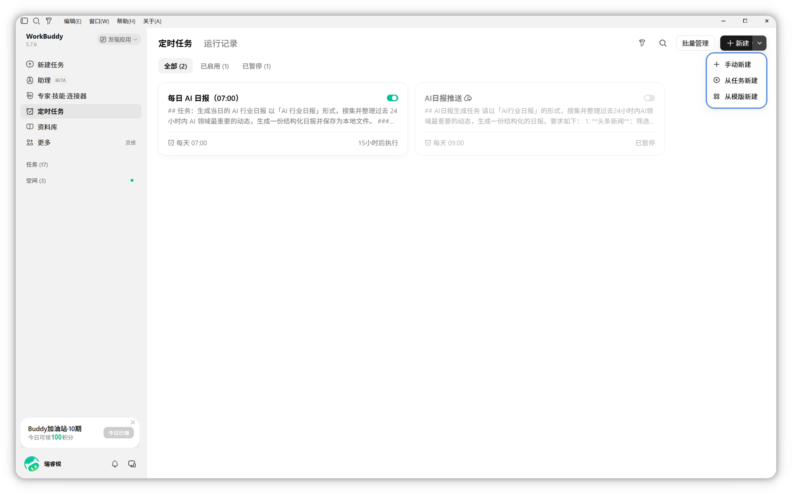
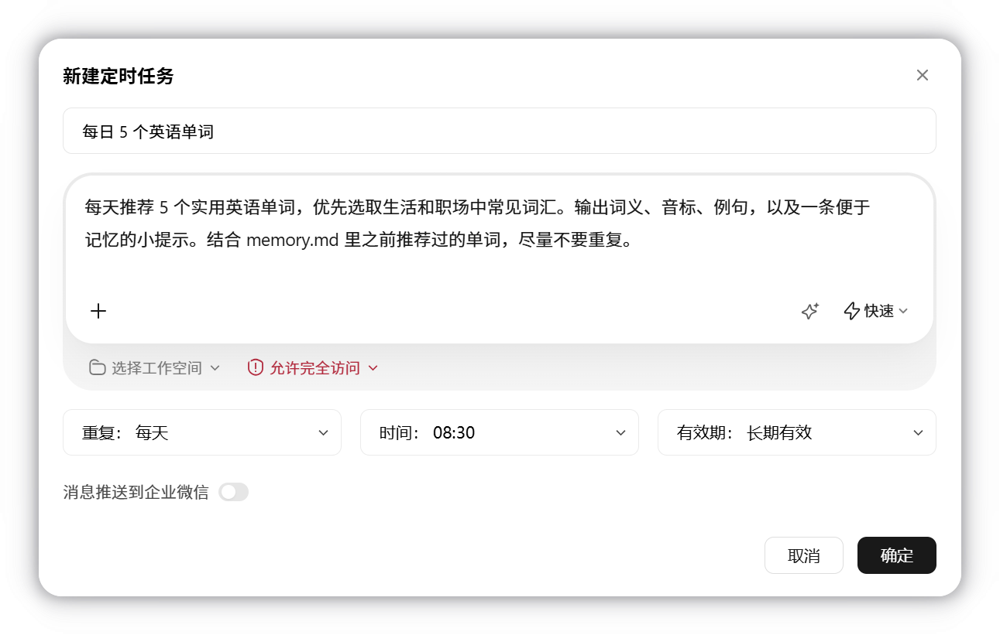

# 用户测试通过后，启用增量定时同步

使用时机：接入配置完成，Agent 已把用户亲自转发的那条测试资料写入飞书并读回，用户也打开目标文档确认正文和图片正确。此前不能直接创建并启用定时任务。

## 1. 主动邀请用户测试，而不是报接入完成就结束

配置完成后一次发齐 grouped-messages 第2组的转发动作与图片，请用户亲自转发一篇愿意测试的资料。Agent 读取指定条目、写入用户确认的位置并读回后，发送实际文档链接：

> 这条测试资料已写入这里：[实际文档链接]。请打开确认正文和图片是否完整。确认没问题后，告诉我多久同步一次；也请确认以后仍保存到这个文档位置和选题模板。首次默认从启用时开始收集新增资料，不自动导入已有历史。

用户只说“测试没问题”而未给频率时，只问还缺的频率；不能自行选一个时间或先创建默认任务。用户已有明确频率、时区或目的地则复用，不重复问。同一条回复可以确认测试、目标、频率和后续新增资料的自动写入范围，减少交接。无可靠图片读回或用户未验收时停在待测试，不启用。

## 2. Agent 准备固定任务目录

复用首次手动测试建立的固定任务目录，不另建第二套基线或队列；没有已有目录时，才由 Agent 在用户独立工作空间下选择新目录，不放在分享包内。记录实际目的地、时间规则、时区（从本机/用户设置核对）、模板 board.json、测试笔记 ID、实际测试文档 URL 和已验证的本机密钥配置路径。后台不得只依赖当前聊天里的环境变量；若密钥原本只在临时环境变量中，按现有密钥配置流程保存并验证本机文件。

用已核实的解释器运行本包 scripts/sync_queue.py，参数由 Agent 从事实填写：

```text
sync_queue.py --job 本次固定目录 init --config 已验证配置文件 --target 实际飞书文件夹位置 --board 实际board.json --cadence 用户确认的规则 --timezone 实际时区 --test-note-id 测试笔记ID --test-doc-url 测试文档URL --user-tested
```

这里只是参数说明，不让用户复制这一行。仅没有旧 job 时初始化会完整扫描已有云端元信息作为基线，之后只处理新增 ID；不会把旧库全量写到飞书。它复制运行脚本到 job/runtime，写 RUN.md、CONTINUE.md 和不含密钥正文的 job.json。重复初始化不覆盖原目录；恢复已有目录先 status。初始化不创建宿主定时任务，也不代表已启用。

首次测试已有 job 时不重新执行 init，也不手改 job.json。用户打开测试文档验收、确认频率与时区后，先 run-claim 取得整轮运行锁，再在同一目录执行：

```text
sync_queue.py --job 本次固定目录 --owner 本轮标识 finalize --cadence 用户确认的规则 --timezone 实际时区 --test-note-id 已完成测试ID --test-doc-url 已绑定测试文档URL --user-tested
```

只有队列中已 done、文档 URL 匹配且用户本人验收，才能登记。命令保留原基线、资料、正文、改写、版本及模板映射；不会启用定时。登记后释放本轮锁，再创建或复用真实宿主任务、试跑、核对去重，最后 schedule-receipt 登记真实回执。未 finalize 的 manual 任务不能登记定时成功。已有定时不得只改本地频率，必须同步核对宿主任务。任务目录包含运行时副本、正文缓存和读回回执，属于用户本机私人工作目录；只把不含密钥的任务指令交给宿主调度器，不上传整个目录。保存实际 board 映射，手动和定时均按同一 RUN.md 与 recording-rules.md 写正文和选题索引。

## 3. 创建定时：按实际宿主能力走一条路

### 当前 Agent 可以创建

先查同一 job 对应的任务 ID 或名称，存在就复用/按用户规则更新，不建重复任务。使用当前宿主的真实定时工具，把名称、已确认时间规则和时区、工作空间、所需 lark skills/连接器与运行指令一起设置。定时提示词只需指向固定目录 RUN.md，并说明执行新增同步、无变化静默、异常报告；不嵌入密钥、token、device_code 或授权链接。创建结果要读回任务详情，核对目标、时间规则、时区、下一次时间、工作空间、执行权限。

WorkBuddy 官方支持在普通对话直接提出周期需求创建任务，不必默认另开聊天。Agent 能操作的填表、目录、提示词和图片准备都由 Agent 做。

### 当前窗口没有创建工具，但 WorkBuddy 有定时入口

先完成上面的固定目录和 CONTINUE.md，把需要的任务名、规则、工作目录和提示词准备成可直接带过去的一段说明。能够打开对应入口/填写表单就由 Agent 做；只有宿主必须本人点击时，才一次发齐以下整组操作和两张原图：

> 这份任务的内容和配置已经准备好。请进入左侧“定时任务”→右上角“新建”下拉→“从任务新建”，在打开的任务窗口发送我准备好的说明。若是手动编辑窗口，按准备好的内容设置名称、提示词、工作空间和重复时间，核对后点“确定”。完成后把任务链接或任务卡片信息告诉我，我继续核对并试跑；不用重新获取密钥或创建飞书应用。





这两图只示意入口与表单，图中名称、时间和目录不照抄；Agent 用用户实际信息准备。接续消息只包含固定目录的 RUN.md/CONTINUE.md 路径、任务目标及已确认规则，不含密钥。新窗口同样必须核实是否有创建能力；换普通聊天本身不能保证能定时。

### 当前宿主完全没有定时能力

明确报告“测试已通过，定时尚未设置”，保留固定目录与续接说明。可带到支持定时的同机入口继续；不伪造任务 ID、不把睡眠/循环查询当定时、不悄悄安装系统常驻服务。用户后来明确选择系统调度器或云端方案时再准备对应方案。不要用 Codex 的调度工具替用户创建一条声称属于 WorkBuddy 的任务。

## 4. 必须从定时任务本身立即试跑

1. 创建任务后先核对任务卡片的规则和下一次执行时间；没有详情回读就只能报告待核对。
2. 在宿主任务上使用“立即运行”，核对后台实际能读固定目录、配置文件、官方 skills 和飞书授权；不能用当前对话里跑一遍代替。
3. 初始化基线后没有新增时，空跑仅验证可启动与扫描，不能证明自动写入成功。此时请用户再转发一条愿意测试的资料，仍一次发齐第2组动作与图片；然后从同一定时任务立即运行，观察新增入队、创建、读回、done 记录。
4. 本次试跑成功后再立即运行一次，确认不会创建第二份。用户不需要重新授权每次写入，范围只限已确认目的地与新增资料。
5. 把真实宿主任务 ID、下一次执行时间、成功试跑运行 ID 通过 schedule-receipt 登记到 job.json。该命令只保存已核实回执，不会自行创建或验证宿主任务，不能用虚构值过关。
6. 报告实际任务入口、规则/时区、下一次执行时间、试跑新文档链接、重复运行结果和运行记录位置。只有真实完成这些才说“自动同步已启用”。创建成功但后台待权限确认、空跑未写入、读回失败或用户未测试都要标为待验证。

若宿主允许先暂停保存任务再立即运行，优先先验证后启用；如只能创建即启用，在试跑未通过时由 Agent 暂停该任务并说明实际状态。暂停/启用以当前宿主支持为准，不假装有该功能。

## 5. 执行条件与权限

默认采用同机本地任务，与已验证的本机密钥和 lark-cli 登录态保持一致。本地任务运行时电脑和客户端须可用；电脑关闭或客户端退出时不能承诺准时运行。WorkBuddy 的云端任务不能读本机文件，未迁移并验证依赖与凭证前不改成云端。

默认权限可能让后台任务停在待确认。Agent 先查实际能否对本任务目录/所需命令授予有限、持久的许可；没有此能力就明确说明边界，不宣称无人值守。若宿主只提供会扩大访问范围的“完全访问”选项，先说明实际影响并交由用户本人决定，不能自动打开全局完全访问。用户拒绝时保留待确认模式，并如实报告不保证无人值守。

授权过期、缺权限、无法处理图片、写入结果不明或锁残留时按 RUN.md 的恢复流程处理。成功/无新增不反复打扰；需要本人登录、权限确认或核对不明写入时再通知。

[WorkBuddy 官方定时任务说明](https://www.codebuddy.cn/docs/workbuddy/From-Beginner-to-Expert-Guide/Function-Description/Automation-Guide)。页面变化时先打开当前说明核对入口、频率限制、运行时长和任务权限，不硬编码假设。

单项资料未就绪或暂时查不到时保留重试，不拖住后续正常资料；本轮暂缓项通过临时 --skip-id 继续，下轮重新核对。仍有待办时明确报告，不能将 retry_pending 当作全部成功。认证、网络或权限问题停止本轮。
