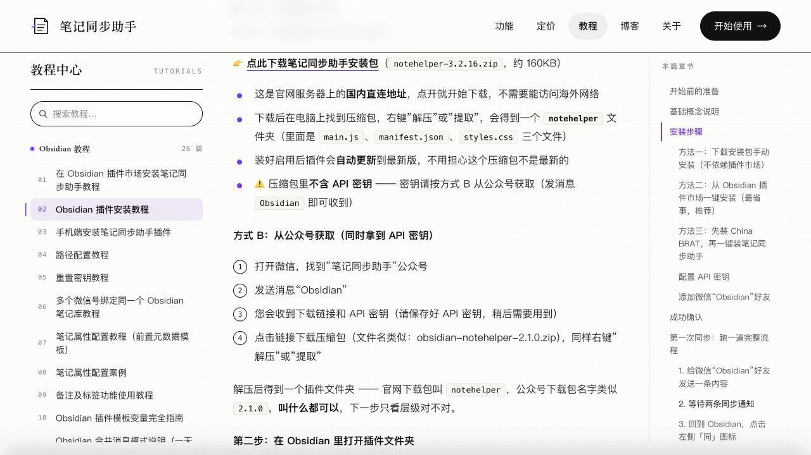
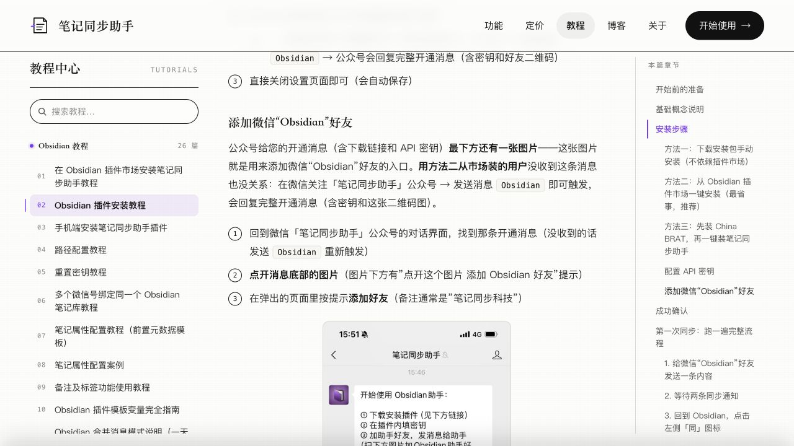
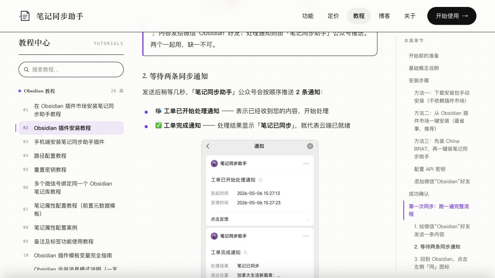
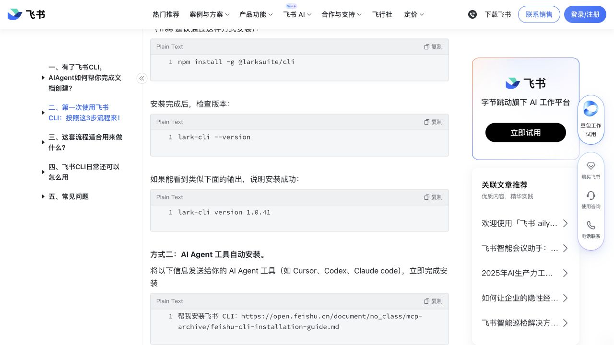
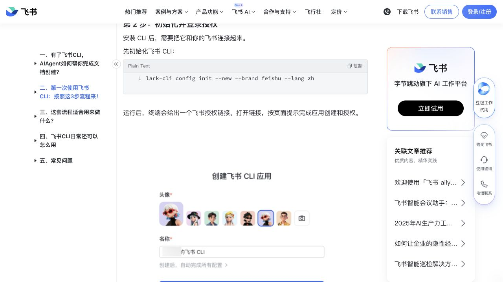
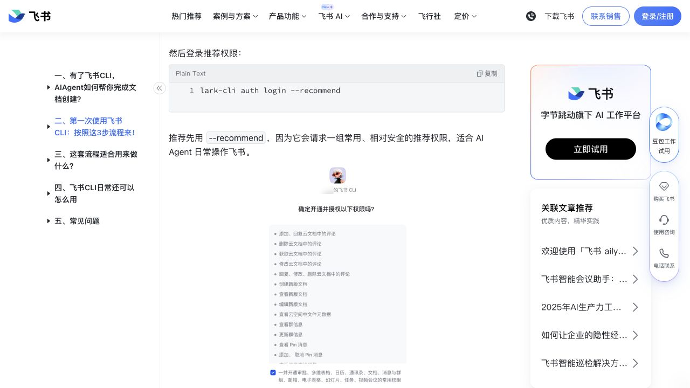

# 接入步骤图解

实际交互按 [整组发送示例](grouped-messages.md)组织：第 1 组关注/取密钥/加好友/置顶，第 2 组转发/查看完成通知，第 3、4 组为确实需要的飞书创建和授权；测试通过后，第5组合并确认验收和定时规则，第6组只在确需本人进入定时入口时发送。每组全部连续动作和对应图片一次发齐，用户整组完成后回复一次；下面的图片小节不是逐点确认轮。

新增 [微信置顶隐私处理图](../assets/user-guide/wechat-pin-redacted.png)：用户提供截图的 AI 辅助打码版，不属于官方原图。图片顶部已标“已置顶，不用点取消”；右键菜单显示“取消置顶”表示已经置顶，未置顶才点“置顶”；不让用户点击“取消置顶”。其它聊天头像、名称与消息已遮盖，原始截图不放进分享包。

## v0.8：补齐手机连续动作示意

四张新增 PNG 均为本项目制作的操作示意，图内标明“非真实截图”；用于搜索、关注、发送 Obsidian、手机置顶的动作说明。与原有官方开通消息、添加按钮和电脑置顶图一起在第1组一次发齐，不能只发新增图或逐图等待确认。

| 操作 | 新增配图 |
|---|---|
| 微信搜索服务号 | [搜索操作示意](../assets/user-guide/wechat-phone-search.png) |
| 关注、进入发消息页 | [关注操作示意](../assets/user-guide/wechat-phone-follow.png) |
| 切换文字输入、发送 Obsidian | [发送操作示意](../assets/user-guide/wechat-phone-send-obsidian.png) |
| 手机开启置顶，已开启就保持 | [手机置顶操作示意](../assets/user-guide/wechat-phone-pin.png) |

来源与哈希见 assets/user-guide/manifest.json。每种手机登录和组织审批页面仍以真实动态页面为准。

## v0.3：优先使用官方手机原图

原图保存在 `assets/official/`；来源、下载日期、SHA-256 和使用限制见同目录 `manifest.json`。之前九张网页截图保留作背景参考，具体按钮优先看以下原图。Agent 展示时解析为真实绝对路径，实际显示图片，附对应官方链接。

| 用户当前操作 | 对应原图 | 详细话术 |
|---|---|---|
| 关注服务号 | wechat-service-account-qr.jpg | [A1](notehelper-setup.md#a1-先关注服务号) |
| 切文字输入、发送 Obsidian、找密钥 | wechat-opening-message.png | A2—A3；原图是开通结果，非发送动作截图 |
| 找自己的好友入口并添加 | wechat-opening-message.png、08-add-phone.png | B1 |
| 置顶接收资料的助手 | ../assets/user-guide/wechat-pin-redacted.png | B1a；取消置顶说明已置顶 |
| 转发给朋友 | 09-first-share-phone.png | B2 |
| 选择自己的助手好友 | 10-choose-chat-phone.png | B3 |
| 点发送、看已发送 | 11-send-phone.png、12-sent-phone.png | B4 |
| 查看服务号通知 | 14-service-phone.png、wechat-notifications.jpg | B5 |
| 联系官方客服 | wechat-customer-service.png | [条件排障](help-and-official-docs.md) |
| 创建飞书应用 | feishu-create-app.png | [飞书第 3 步](feishu-setup.md) |
| 确认飞书授权 | feishu-user-consent.png | 飞书第 4 步；历史全权限示例不可照搬 |

标有 `-phone` 的图片来自官方 OneNote 教程，只展示微信通用按钮；本包实际使用自己的 Obsidian 助手，不连接 OneNote。微信搜索、关注和手机置顶已增加明确标注的操作示意；这些及每种手机登录、审批页面仍没有本包官方逐屏图，已在详细指引中区分。不得用生成图冒充真实截图；遇到差异先查[官方说明入口](help-and-official-docs.md)。

以下保留 v0.1/v0.2 的网页截图说明：

官方公开教程截图，采集于 2026-10-21。截图用于认位置，真实状态由 Agent 实际校验。链接来源见 [sources.md](sources.md)。

## 1. 在公众号取自己的 API 密钥

用户操作：微信关注“笔记同步助手”，发送 `Obsidian`。拿到开通消息后继续取密钥、添加并置顶好友；第1组全部完成后再回复一次。此处不必装 Obsidian。

## 2. 密钥交给 Agent

用户在 Agent 对话框提供自己的密钥，由 Agent 保存并校验；聊天和工具记录可能留存。当前指引用完整开通消息原图辨认密钥位置，不展示 Obsidian 插件设置路线。

## 3. 添加微信接收助手

用户操作：点自己开通消息底部图片，按当前入口添加好友。不要把示例图当成自己账号的绑定入口。

## 4. 分清收到和处理完成

转发到助手好友后，服务号会通知处理状态。“笔记已同步”是云端就绪，下一步由 Agent 拉取，再按用户指令保存飞书。

## 5. Agent 接的是官方 NoteHelper

它负责向笔记云库保存、检索，飞书的写入由后续 CLI 完成。

## 6. 飞书 CLI 安装

Agent 执行安装和版本检查；用户不用抄命令。图中的版本号只作示例。

## 7. 飞书应用创建

仅当 Agent 检查确认确实需要创建应用时才展示：用户打开本次配置链接/二维码完成创建。已连接的用户跳过此图和此步骤。

## 8. 飞书个人授权

用户操作：核对账号、应用和本次所需权限后确认，回来回复“已授权”。Agent 再验证登录。**图中的 --recommend 是旧教程示例，本包使用 docs,drive,base。**

## 9. 官方服务来源（Agent 内部参考）

官方 NoteHelper 连接同一个笔记云库；本包通过附带客户端读取。用户统一使用微信转发入口，不展示其它安装和收藏选项。原始网页截图文件保留供来源核对。

## 10. 看板暂空

看板地址、表格 ID、字段映射保持未设置。测试后的文件夹增量定时同步另按 scheduling-setup.md 配置，不把看板占位当作任务状态。

## 11. 测试后定时：确需本人操作时整组展示

Agent 能设置则代为设置；确需用户点击时，一次给齐“定时任务→新建→从任务新建/手动填写→核对→确定”及实际任务内容。图中示例时间、目录、权限不照抄；不自动打开完全访问。

[官方来源与执行条件](https://www.codebuddy.cn/docs/workbuddy/From-Beginner-to-Expert-Guide/Function-Description/Automation-Guide)。完整操作与新窗口续接见 [定时设置](scheduling-setup.md)。
